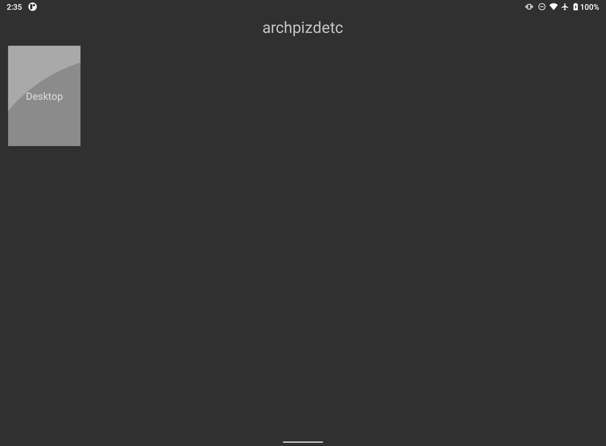
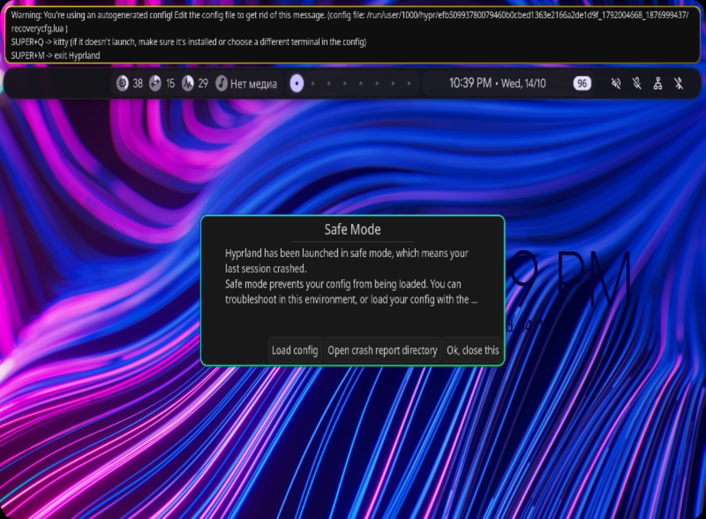

# nx-rust

Свой GameStream/NX-сервер на Rust: стримит Linux-десктоп на Android-планшет
через [Moonlight](https://moonlight-stream.org/). Захват: `wlr-screencopy`
(Hyprland/sway), `xdg-desktop-portal` + PipeWire (KDE Plasma/GNOME Wayland)
или `ffmpeg x11grab` (KDE Plasma X11/любой Xorg) → H.264 (VA-API или
libx264) → RTP; звук PipeWire → Opus → RTP с FEC. В комплекте — обвязка для
USB-канала, watchdog и модуль питания планшета.

**Статус: экспериментальный личный проект, не продукт.** Основной стенд:
Arch Linux + Hyprland + AMD Carrizo (VA-API) + планшет MediaTek (Android 11)
+ Moonlight 12.2. KDE Plasma **поддерживается**: Wayland — через штатный
портал ScreenCast (KWin не умеет `wlr-screencopy`), X11 — через x11grab.
На живом KDE-железе проект ещё не прогонялся; чек-лист и ограничения — в
разделе «KDE Plasma».

| Клиент (Moonlight) | Хост (HEADLESS-вывод) |
|---|---|
|  |  |

## Что умеет

- **NVHTTP/HTTPS**: `serverinfo`, `applist`, `launch`, pairing по PIN,
  самоподписанный сертификат, mDNS-объявление `_nvstream._tcp`.
- **Видео**: три backend'а захвата — `wlr-screencopy` (Hyprland/sway,
  виртуальный `HEADLESS-*`), `xdg-desktop-portal` ScreenCast + PipeWire
  (KDE Plasma/GNOME Wayland) и `ffmpeg x11grab` (KDE Plasma X11). Энкодер:
  собственный VA-API (dmabuf → VPP → H.264, zero-copy) или ffmpeg
  `h264_vaapi`/`libx264`. 1088×800@60, 16 Мбит/с — проверенный режим;
  разрешение/битрейт задаёт клиент.
- **Звук**: Opus 300 кбит/с, 200 data-пакетов/с + 100 FEC-пакетов/с,
  RS(6,4) с паритетом над зашифрованными шардами (как в Sunshine). Задержка
  применяется в форвардере, а не в ffmpeg.
- **Ввод**: тачскрин, кнопки, стики — через ENet control-канал.
- **Замеры**: медиана сквозной задержки **44–47 мс** на 1088×800/60 через
  USB RNDIS; методика и сырые данные — `evidence/latency-2026-10-21.md`.
- **Обвязка** (опционально): watchdog USB-RNDIS, модуль питания планшета,
  роутинг звука по окнам Hyprland, скрипты bring-up.

## Архитектура

```
┌──────────────┐   NVHTTP/TLS 48984/48989   ┌───────────────────────────────┐
│  Moonlight   │◄──────────────────────────►│  nx-server (Rust)             │
│  (Android)   │   RTSP 49010               │  ├─ nvhttp/pairing            │
│              │   RTP video 49000          │  ├─ stream/{rtsp,control}     │
│              │   ENet control 49001       │  ├─ vaapi encoder             │
│              │   RTP audio 49002          │  └─ mDNS _nvstream._tcp       │
└──────────────┘                            └──────────┬────────────────────┘
                                                       │ wlr-screencopy
                                                       ▼
                                            ┌───────────────────────┐
                                            │ Hyprland HEADLESS-*   │
                                            │ 1088×800@60           │
                                            └───────────────────────┘
```

Порты нестандартные (489xx), чтобы не конфликтовать с Sunshine (479xx).
Moonlight находит сервер по mDNS; при ручном добавлении нужен HTTP-порт
`48989`.

## Совместимость

| Компонент | Статус |
|---|---|
| Хост | Arch Linux — проверено. Другие дистрибутивы с Wayland/X11 и PipeWire — вероятно, но не тестировались; зависимости ниже. |
| Композитор | **Hyprland** — проверено (`wlr-screencopy` + `HEADLESS-*`). **KDE Plasma Wayland** — поддержано через `xdg-desktop-portal` ScreenCast + PipeWire. **KDE Plasma X11** — поддержано через `x11grab`. Sway — вероятно (нужен headless-вывод заранее). GNOME Wayland — тот же портал, не тестировался. |
| GPU | AMD VA-API (Carrizo) — проверено; Intel VA-API — вероятно; NVIDIA — VA-API нет, но работает программный `libx264` (`NX_FFMPEG_ENCODER=x264`). NVENC не реализован. |
| Клиент | Moonlight Android 12.2 (315) — проверено. Другие клиенты Moonlight — теоретически, протокол общий. |
| Root на планшете | **Не нужен** для WiFi-режима. Нужен только для USB-автоматики конкретного MediaTek-гаджета (см. ниже). |
| Звук | PipeWire или PulseAudio. На KDE — monitor дефолтного sink'а. |
| Ввод | `uinput`; нужен доступ к `/dev/uinput` (группа `input`). На KDE Wayland работает через KWin/libinput. |

### KDE Plasma

KWin не реализует `zwlr_screencopy_manager_v1`. Вместо него используются
штатные пути:

- **KDE Plasma Wayland** — `xdg-desktop-portal` ScreenCast + PipeWire.
  Сервер сам открывает сессию портала; KDE показывает диалог выбора
  монитора/окна. Первый запуск требует подтверждения; restore-токен
  сохраняется в `~/.local/state/nx-rust/portal.restore_token` и
  переиспользуется.
- **KDE Plasma X11** — `ffmpeg x11grab`, снимает весь X11-экран. Портал не
  нужен, но нужен `DISPLAY`.

Что установить (Arch Linux):

```bash
sudo pacman -S --needed rust cargo pkgconf ffmpeg libva libva-utils \
  pipewire pipewire-pulse wireplumber \
  xdg-desktop-portal xdg-desktop-portal-kde \
  kscreen xorg-xrandr python
```

`pipewire` содержит `libpipewire-0.3` и заголовки; `pkgconf` нужен для
сборки. Debian/Ubuntu: `libpipewire-0.3-dev xdg-desktop-portal
xdg-desktop-portal-kde x11-xserver-utils pkg-config`. Fedora:
`pipewire-devel xdg-desktop-portal xdg-desktop-portal-kde xrandr pkgconf`.

Проверка backend'а и сборка:

```bash
cargo build --release
./target/release/nx-server backend
# Wayland: xdg-desktop-portal/PipeWire
# X11:    x11grab
```

Запуск:

1. Запускайте сервер **изнутри KDE-сессии** (терминал или systemd user
   unit), чтобы были `DBUS_SESSION_BUS_ADDRESS` и `XDG_RUNTIME_DIR`.
   `launch_nx.sh` подхватывает их из `plasmashell`, если сервис стартует
   из systemd.
2. `./launch_nx.sh` (или `nx-server serve ...`).
3. Подключите Moonlight и запустите Desktop. При первом ANNOUNCE KDE
   покажет диалог «Поделиться экраном»; выберите **монитор** (не окно) и
   разрешите. Сервер ждёт ответа — это нормально.
4. Если диалог не появился: `./scripts/doctor.sh`; проверить
   `busctl --user introspect org.freedesktop.portal.Desktop \
   /org/freedesktop/portal/desktop org.freedesktop.portal.ScreenCast`;
   перезапустить `xdg-desktop-portal-kde`.
5. Ввод: `ls -l /dev/uinput`; если нет доступа —
   `sudo usermod -aG input "$USER"` и перелогиниться. На KDE Wayland
   uinput-устройство подхватывает KWin/libinput.
6. Звук: `launch_nx.sh` по умолчанию берёт monitor дефолтного sink'а
   (`pactl get-default-sink`). Планшет слышит весь звук хоста; динамики
   хоста тоже играют. Если нужен только стрим — задайте
   `NX_AUDIO_SOURCE=nx_stream.monitor` и маршрутизируйте приложения в
   `nx_stream` вручную (pavucontrol или настройки KDE).
7. Мультимонитор: портал отдаёт выбранный монитор; ввод маппится через
   геометрию KScreen. Если координаты тача смещены — проверьте
   `kscreen-doctor -j` и выберите монитор, начинающийся с `(0,0)`.
8. Блокировка экрана: портал снимает то, что показывает KWin; при
   автолоке в кадр попадёт экран блокировки. Отключите автолок на время
   стрима или увеличьте таймаут.

Ограничения KDE-пути:

- задержка портала выше `wlr-screencopy` на 1–2 кадра (композитор +
  PipeWire); ориентир — те же 16 Мбит/с и 60 fps, но медиану 44–47 мс
  измеряли на Hyprland, не на KDE;
- разрешение ScreenCast — обязательный диалог KDE; restore-токен может
  не сработать после обновления портала;
- multi-GPU/VRR/10-bit HDR не проверялись; формат — BGRx/BGRA 8-bit;
- per-window audio routing как в Hyprland-роутере нет: звук — общий
  monitor дефолтного sink'а.

### Планшет без root

- **WiFi-режим**: работает всё, что нужно для стрима. Установите Moonlight,
  подключите планшет и хост к одной сети, добавьте хост по mDNS или IP.
- **USB-режим**: включите USB-тетеринг в настройках Android (Настройки →
  Сеть → Точка доступа → USB-тетеринг). Хост увидит RNDIS-интерфейс.
  Наш `fix_gadget3.sh`, статические адреса и fwmark-маршрут — специфика
  конкретного MediaTek-гаджета; для них нужен `su`/Magisk. Без root эти
  шаги пропустите.
- **Модуль питания**: работает без root (adb + `dumpsys battery` + sysfs).
  Без root не читается `dmesg`, поэтому диагностика регистров зарядчика
  будет пустой; остальное доступно.

## Быстрый старт

### 1. Зависимости

Arch Linux:

```bash
sudo pacman -S --needed rust cargo pkgconf ffmpeg libva libva-utils \
  pipewire pipewire-pulse wireplumber wayland wayland-utils \
  xdg-desktop-portal xdg-desktop-portal-kde kscreen xorg-xrandr \
  android-tools python
```

`pkgconf` и заголовки `libpipewire-0.3` (пакет `pipewire`) нужны для
сборки KDE-портального backend'а. Debian/Ubuntu:
`libpipewire-0.3-dev xdg-desktop-portal xdg-desktop-portal-kde
x11-xserver-utils pkg-config`. Fedora: `pipewire-devel xdg-desktop-portal
xdg-desktop-portal-kde xrandr pkgconf`.

Для AMD нужен `mesa` (обычно уже стоит). Для Intel — `intel-media-driver`
или `libva-intel-driver`. Проверка:

```bash
vainfo | grep -A2 H264High
```

Должны быть `VAEntrypointEncSlice` (энкодер) и `VAEntrypointVLD` (декодер).
Если VA-API нет (например, NVIDIA), сервер соберётся и запустится с
программным `libx264`: задайте `NX_FFMPEG_ENCODER=x264`. Это медленнее,
но 1088×800@60 на современном CPU обычно тянет.

### 2. Сборка

```bash
git clone <URL> nx-rust
cd nx-rust
cargo build --release
```

### 3. Виртуальный вывод (только Hyprland/wlroots)

На KDE этот шаг **не нужен**: портал отдаёт выбранный монитор, а x11grab
снимает весь X11-экран. Всё ниже — для Hyprland/sway.

Сервер сам создаст `HEADLESS-*` через `hyprctl`, если вывода нет. Чтобы
картинка была пиксель-в-пиксель, задайте режим 1088×800@60. В Hyprland:

```conf
# hyprland.conf
monitor=HEADLESS-1,1088x800@60,0x0,1
```

или на лету:

```bash
hyprctl keyword monitor "HEADLESS-1,1088x800@60,0x0,1"
```

Игры/окна запускайте на этом выводе (перетащите окно или используйте
workspace-правило). Захватывается весь вывод, поэтому панель/док тоже
попадут в кадр — для «полного десктопа» это нормально.

### 4. Запуск

Минимальный вариант (звук — monitor дефолтного sink'а, всё аудио хоста
уходит в стрим):

```bash
export NX_BITRATE_KBPS=16000
export NX_CAPTURE=auto              # KDE Wayland → portal, KDE X11 → x11
export NX_FFMPEG_ENCODER=auto       # VA-API, если есть; иначе libx264
# export NX_ENCODER=vaapi           # только Hyprland/wlroots (in-process VA-API)
export NX_AUDIO_BITRATE_KBPS=300
export NX_AUDIO_DELAY_MS=80
./target/release/nx-server serve --name "$(cat /proc/sys/kernel/hostname)" --pin 1234
```

Рекомендуемый вариант — через `launch_nx.sh`: он создаёт sink `nx_stream`,
keepalive, поднимает роутер звука (Hyprland), а на KDE берёт monitor
дефолтного sink'а, и передаёт настройки:

```bash
sudo mkdir -p /etc/nx-rust
sudo cp config/nx.env.example /etc/nx-rust/nx.env
sudoedit /etc/nx-rust/nx.env     # NX_SERVER_DIR, PIN, NX_CAPTURE=auto
./launch_nx.sh
```

`launch_nx.sh` можно запускать и без `/etc/nx-rust/nx.env` — тогда пути
берутся от каталога скрипта, имя — от hostname, остальное — дефолты.

### 5. Сопряжение

1. Откройте Moonlight → «Добавить ПК». Сервер должен найтись сам по mDNS;
   если нет — введите IP хоста (HTTP-порт `48989`).
2. Введите PIN из `--pin` (по умолчанию `1234` — смените).
3. Выберите приложение «Desktop» (или игру, если добавили её в `applist`).
4. Настройки клиента: 1088×800, 60 fps, 16 Мбит/с, HDR off, frame pacing
   «latency», звук stereo.

### 6. Проверка

```bash
./scripts/doctor.sh
```

Скрипт только читает: backend (`wlr-screencopy` / portal / x11grab), портал
ScreenCast и PipeWire, VA-API или libx264, звук, порты, state dir. Exit 1 —
есть блокеры. На KDE проверяется портал (а не `wlr-screencopy`); на X11 —
x11grab.

## Конфигурация

Все настройки — переменные окружения. Их можно положить в
`/etc/nx-rust/nx.env` (пример — `config/nx.env.example`); файл читают
`watchdog.py`, `tablet_power.py` и `launch_nx.sh`. Окружение имеет приоритет
над файлом.

`NX_SERVER_DIR`, `NX_SERVER_NAME`, `NX_SERVER_PIN` и `NX_WAYLAND_DISPLAY`
читают скрипты; сам `nx-server` принимает `--name`, `--pin`, `--output`,
`--http-port`, `--https-port`. Остальные `NX_*` (битрейт, энкодер, аудио)
читает сервер.

| Переменная | По умолчанию | Смысл |
|---|---|---|
| `NX_SERVER_DIR` | каталог репозитория | абсолютный путь (нужен systemd-юнитам) |
| `NX_SERVER_NAME` | hostname | имя в Moonlight |
| `NX_SERVER_PIN` | `1234` | PIN сопряжения |
| `NX_WAYLAND_DISPLAY` | авто | Hyprland часто `wayland-1`, KDE — `wayland-0`; можно не задавать |
| `NX_CAPTURE` | `auto` | `auto` / `wlr` / `portal` / `x11`; на KDE обычно auto |
| `NX_OUTPUT` | `auto` | только wlr: первый `HEADLESS-*` или имя вывода; на KDE игнорируется |
| `NX_BITRATE_KBPS` | клиентский | видео-битрейт, проверено 16000 |
| `NX_ENCODER` | `ffmpeg` | `vaapi` — свой in-process энкодер (только wlr/dmabuf), иначе ffmpeg |
| `NX_FFMPEG_ENCODER` | `auto` | `auto` = VA-API, если `vainfo` подтверждает H.264 encode, иначе libx264; `x264` — принудительно |
| `NX_VAAPI_DEVICE` | `/dev/dri/renderD128` | render node для ffmpeg VA-API |
| `NX_GOP` | `40` | размер GOP |
| `NX_AUDIO_BITRATE_KBPS` | `96` | Opus, проверено 300 |
| `NX_AUDIO_DELAY_MS` | `0` | задержка аудио в форвардере, проверено 80 |
| `NX_AUDIO_SOURCE` | monitor дефолтного sink'а | `nx_stream.monitor` для роутера |
| `NX_STATE_DIR` | `~/.local/state/nx-rust` | `uniqueid`, сертификат, ключ |
| `NX_PIN_WAIT` | — | `0` — не ждать PIN при pairing |
| `NX_HOST_IP` / `NX_TABLET_IP` | `192.168.8.1` / `.89` | RNDIS-адреса |
| `NX_TABLET_SUBNET` | `192.168.8.0/24` | RNDIS-подсеть |
| `NX_TABLET_SERIAL` | серийник планшета | привязка adb watchdog к своему устройству |
| `NX_USER` / `NX_UID` | владелец репозитория | от кого запускать Wayland/PipeWire |
| `NX_QUICKSHELL_UNIT` | пусто | личный quickshell автора; в чужом окружении не задавать |

Важно: `NX_STATE_DIR` должен переживать рестарты. Если потерять `uniqueid`
или сертификат, Moonlight решит, что это другой ПК («Polling returned the
wrong PC»), и pairing придётся проходить заново.

## Обвязка (опционально)

### `watchdog.py` — USB-RNDIS

Лечит зависший USB-канал: `USBDEVFS_RESET`, восстановление адресов,
fwmark-маршрута, mDNS-членства и переподключение Moonlight. Нужен только
в USB-режиме; для WiFi не требуется.

```bash
sudo cp systemd/nx-watchdog.service /etc/systemd/system/
sudo systemctl daemon-reload
sudo systemctl enable --now nx-watchdog.service
```

Юнит требует `NX_SERVER_DIR` в `/etc/nx-rust/nx.env`. Watchdog работает
root'ом (USB-сброс, адреса), а действия в сессии делает через `sudo -u
$NX_USER`. На планшете для gadget/fwmark нужен `su`; без root эти шаги
деградируют, остальное работает. В юните стоит `KillMode=process`: рестарт
watchdog'а не убивает `nx-server` (он запускается через `setsid`).

Диагностика без восстановления:

```bash
python3 watchdog.py --check
```

### `scripts/tablet_power.py` — питание планшета

Гасит `com.limelight`, когда стрим не идёт (экономия ~150 мА), следит за
зарядом и правилом «пассивный заряд ≥ 50% от пикового активного разряда».
Пишет `/run/tablet_power.json` и `/var/log/nx-tablet-power.log`.

```bash
sudo cp systemd/nx-tablet-power.service /etc/systemd/system/
sudo systemctl daemon-reload
sudo systemctl enable --now nx-tablet-power.service
```

Модуль не требует root на планшете (adb + battery sysfs + dumpsys).
Подробный разбор, почему USB-A-порт не заряжает этот планшет, — в
`evidence/tablet-battery-2026-10-22.md`.

### `scripts/nx_audio_router.py` — звук по окнам

Hyprland-специфично: приложения, чьи окна на `HEADLESS-*`, уходят в
`nx_stream`; остальные играют в дефолтный sink хоста. Без роутера весь
звук десктопа дублируется на планшет. Запускается из `launch_nx.sh`.

### `scripts/tablet_bringup.sh` — USB bring-up

Поднимает adb/RNDIS после ребута, ставит Magisk-модуль `libui_gralloc_fix`
(опционально), проверяет CPU/декодер. Это скрипт под конкретный
MediaTek-гаджет; для обычного Android с USB-тетерингом не нужен.

### `tools/` — диагностика

Пробники VA-API, dmabuf, захвата. `tools/patch_libui_gralloc.py` патчит
проприетарную `libui.so` на планшете (нужен Magisk) — используйте только
если понимаете, что делаете; к основному стриму это не относится.

## Troubleshooting

| Симптом | Причина | Что делать |
|---|---|---|
| Moonlight: «Offline», хост не находится | mDNS не доходит (фаервол, другой интерфейс, 5353 занят) | `ss -lunp \| grep 5353`; разрешить UDP 5353; добавить хост по IP |
| Ручное добавление по IP не подключается | клиент ждёт стандартный HTTPS-порт 47984 | добавьте по mDNS; либо запустите с `--http-port 47989 --https-port 47984` (если Sunshine не нужен) |
| TLS alert 70 / connection reset | клиент шлёт TLS 1.2, а rustls собрался без tls12 | в `Cargo.toml` уже включён `tls12`; пересобрать `cargo build --release` |
| Чёрный экран, кадров нет | backend не выбран, нет `HEADLESS-*`, энкодер не стартовал, портал не дал поток | `./target/release/nx-server backend`; `./scripts/doctor.sh`; `hyprctl monitors` (wlr); `DISPLAY` (X11); лог `/tmp/nx-server.log` |
| KDE: диалог «Поделиться экраном» не появился | `xdg-desktop-portal`/`-kde` не запущен или нет DBus | `busctl --user introspect org.freedesktop.portal.Desktop /org/freedesktop/portal/desktop org.freedesktop.portal.ScreenCast`; перезапустить `xdg-desktop-portal-kde`; doctor |
| KDE: выбрал монитор, но чёрный экран | PipeWire не отдал BGRA/BGRx, поток закрылся или выбран не монитор | лог `/tmp/nx-server.log` (`portal: формат`, `portal capture`); выбрать монитор, не окно; `NX_CAPTURE=portal`; doctor |
| KDE: нет ввода (тач/мышь) | нет прав на `/dev/uinput` | `ls -l /dev/uinput`; `sudo usermod -aG input "$USER"`; перелогиниться |
| KDE: нет звука | `NX_AUDIO_SOURCE` указывает на `nx_stream`, но приложения туда не роутятся | `pactl get-default-sink`; убрать `NX_AUDIO_SOURCE` (будет monitor дефолтного sink'а) или настроить роутинг |
| x264 грузит CPU на 100% | нет VA-API, работает программный libx264 | снизить разрешение/fps или включить VA-API (`vainfo`); `NX_FFMPEG_ENCODER=auto` |
| Низкий fps, рывки | GPU-сатурация (Carrizo), тяжёлая игра, DDLC/шейдеры | снизить настройки игры/разрешение; проверить `radeontop`; watchdog поднимает nice |
| Шипение/треск в звуке | sink в IDLE (нет keepalive), недобор пакетов, потеря RTP | проверить 200 pkt/s; `launch_nx.sh` создаёт keepalive; FEC RS(6,4) уже в коде |
| Звука нет | не тот monitor, ffmpeg умер, sink пропал после рестарта PipeWire | `pactl list short sources`; на Hyprland `NX_AUDIO_SOURCE=nx_stream.monitor`, на KDE — monitor дефолтного sink'а; перезапустить `launch_nx.sh` |
| USB-канал завис (ping 100% loss, `errs==packets`) | зависшая TX-очередь RNDIS | перезагрузить **планшет**; watchdog делает USB reset, но при `xHCI HW did not halt` помогает только ребут |
| Планшет не заряжается | USB-A-порт 500 мА, драйвер MTK/SGM41513 выключает заряд | Type-C↔Type-C в порт хоста или сетевой зарядник; модуль покажет `USB_PORT_TOO_WEAK` |
| «Polling returned the wrong PC» | потерян `uniqueid`/сертификат в `NX_STATE_DIR` | вернуть state dir; заново пройти pairing |
| Порты заняты Sunshine | Sunshine слушает 479xx | у нас 489xx, конфликта нет; проверить `ss -ltnup` |

Подробные разборы с цифрами:

- `evidence/latency-2026-10-21.md` — медиана 44–47 мс, разложение по слоям.
- `evidence/audio-hiss-2026-10-21.md` — четыре причины шипения и FEC.
- `evidence/fps-under-load-2026-10-21.md` — почему 60 fps несовместимы
  с тяжёлой игрой на Carrizo.
- `evidence/tablet-battery-2026-10-22.md` — зарядка, регистры, правило 50%.
- `evidence/xhci-wedge-2026-10-20.md` — зависание xHCI из-за RNDIS.

## Работа с агентом OpenCode

В корне лежит `AGENTS.md` — это контракт для агента: что можно, что нельзя,
как проверять. OpenCode читает его автоматически.

Типовой старт:

```bash
cd nx-rust
opencode
```

Первый запрос агенту:

> Прочитай `README.md` и `AGENTS.md`. Запусти `./scripts/doctor.sh` и
> `./target/release/nx-server backend`. Ничего не меняй. Отчитайся: железо,
> композитор (Hyprland / KDE Wayland / KDE X11), backend, что упало, какой
> режим (WiFi/USB) и какие логи смотреть.

Дальше — по одной задаче за раз. Агент должен:

1. Сначала собрать факты (доктор, логи, `ss`, `adb`), потом менять код.
2. Делать минимальную правку, проверять `cargo test`, `bash -n`,
   `python3 -m py_compile`.
3. Для каждого утверждения о причине прикладывать команду/лог/цифру.
4. Результат измерения — в `evidence/YYYY-MM-DD-*.md`.
5. Обновлять README/AGENTS, если поменялись команды или поведение.

Чего агенту делать нельзя (см. `AGENTS.md`):

- трогать Sunshine/NoMachine и чужие сервисы;
- перезапускать композитор, убивать пользовательские приложения;
- открывать портал ScreenCast и запускать `capture`/`encode`/`serve` на KDE
  без разрешения: это видимый диалог и реальный захват экрана;
- писать в `opencode.db` и другие БД;
- выполнять `adb root`/`su` на чужом планшете без разрешения;
- публиковать секреты, ключи, PIN и личные IP;
- обещать «физически невозможно» без замеров.

## Структура репозитория

```
src/
  main.rs              CLI, запуск сервера, state dir, HEADLESS
  nvhttp/              pairing, serverinfo/applist/launch, TLS
  stream/              RTSP, control (ENet), видео-пайплайн, аудио+FEC
  portal.rs            KDE/GNOME Wayland: ScreenCast + PipeWire
  probes.rs            захват: wlr-screencopy / portal / x11grab
  stream/input.rs      uinput, геометрия Hyprland/KDE/X11
  vaapi.rs             свой VA-API энкодер (dmabuf)
  mdns.rs              _nvstream._tcp
  dma.rs               dmabuf-пробники
watchdog.py            USB-RNDIS watchdog
launch_nx.sh           запуск сервера + sink + роутер
scripts/
  doctor.sh            read-only проверка окружения
  tablet_power.py      модуль питания
  nx_audio_router.py   роутинг звука (Hyprland)
  tablet_bringup.sh    USB bring-up (MediaTek)
  measure_latency.py   замер сквозной задержки
systemd/               юниты watchdog и питания
config/nx.env.example  шаблон конфигурации
docs/gamestream-spec.md  разбор протокола
docs/research/         референсные исходники Sunshine (GPL-3.0)
evidence/              замеры и разборы
```

## Безопасность

Проект рассчитан на **доверенную локальную сеть**. Не выставляйте порты
48984/48989/49000–49010 в интернет. Pairing защищён PIN и самоподписанным
TLS-сертификатом, но это не замена VPN. Смените PIN по умолчанию, не
запускайте от root без необходимости, не публикуйте `NX_STATE_DIR`
(там приватный ключ сервера).

## Лицензия и благодарности

Код — **GPL-3.0** (см. `LICENSE`). Это осознанно: в `docs/research/`
лежат референсные исходники [Sunshine](https://github.com/LizardByte/Sunshine)
под GPL-3.0, а сам сервер реализует тот же протокол. Подробности — в
`NOTICE` и `docs/research/README.md`.

- [Moonlight](https://moonlight-stream.org/) — клиент и протокол GameStream.
- [Sunshine](https://github.com/LizardByte/Sunshine) — референсная
  реализация сервера; по ней сверялись порты, pairing, RTP и FEC.
- [moonlight-common-c](https://github.com/moonlight-stream/moonlight-common-c) —
  разбор RTSP/control.
- [Hyprland](https://hyprland.org/) — wlr-screencopy и headless-выводы.
- [PipeWire](https://pipewire.org/) — звук и ScreenCast-поток.
- [xdg-desktop-portal](https://github.com/flatpak/xdg-desktop-portal) и
  KDE/KWin — ScreenCast для KDE Wayland.

Проект не связан с NVIDIA, LizardByte или Moonlight; названия использованы
для описания совместимости.
